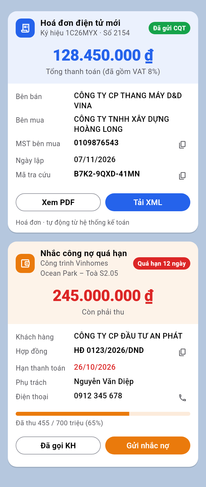
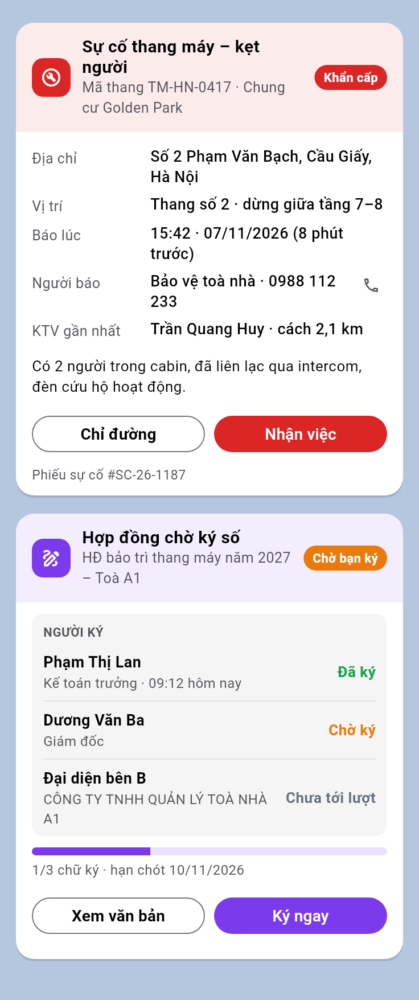
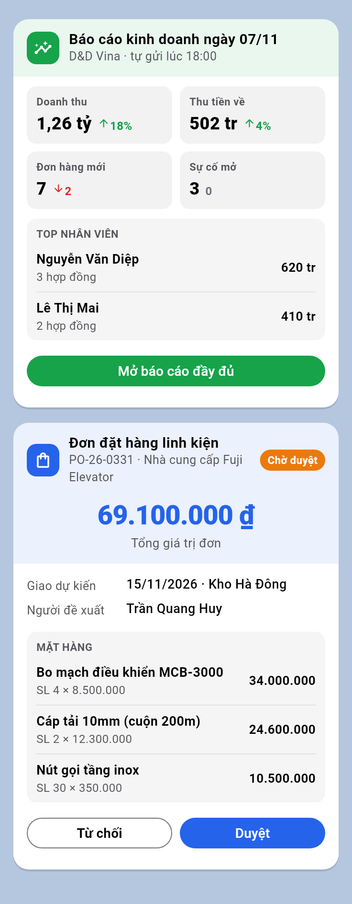
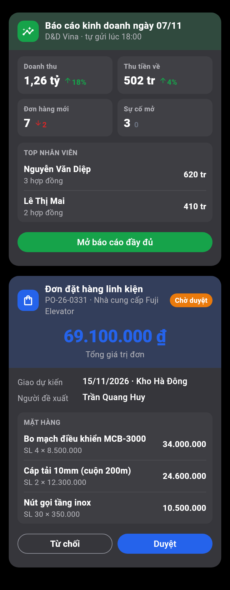
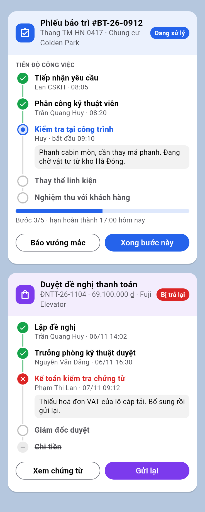

# Thẻ chung `flygo_card`

`flygo_card` là thẻ dữ liệu dùng chung trong Flygo Chat. Bot, quy trình (Flows) hoặc MCP gửi một tin nhắn bình thường, kèm dữ liệu thẻ trong `props.flygo_card`. App sẽ vẽ tin đó thành thẻ: hoá đơn, công nợ, sự cố, văn bản ký số, báo cáo, đơn hàng…

- **Không cần ra bản app mới** cho loại thẻ mới: chỉ cần đổi dữ liệu gửi đi.
- **Tương thích ngược:** app cũ (trước 1.0.3+355; thẻ nhiều bước từ 1.0.3+356) và các ứng dụng khác vẫn hiện phần `message` dạng chữ. Vì vậy luôn ghi `message` đầy đủ, đọc được khi không có thẻ.
- Ghi chú trên tin (vuốt trái sang phải, hoặc nhấn giữ rồi chọn Thêm ghi chú) dán liền ở cuối thẻ.
- Tin từ bot hay của người khác căn trái; tin của chính mình căn phải.

| Hoá đơn · Công nợ | Sự cố · Ký số | Báo cáo · Đơn hàng | Nền tối |
|---|---|---|---|
|  |  |  |  |

## 1. Gửi một thẻ

Tạo post qua REST API như mọi tin khác, chỉ thêm `props.flygo_card`:

```bash
curl -X POST "$SERVER/api/v4/posts" \
  -H "Authorization: Bearer $BOT_TOKEN" -H "Content-Type: application/json" \
  -d '{
    "channel_id": "<channel>",
    "message": "Hoá đơn 1C26MYX-2154: 128.450.000 ₫, bên mua CÔNG TY TNHH XÂY DỰNG HOÀNG LONG. Đã gửi CQT.",
    "props": {
      "flygo_card": {
        "v": 1,
        "icon": "invoice",
        "accent": "blue",
        "title": "Hoá đơn điện tử mới",
        "subtitle": "Ký hiệu 1C26MYX · Số 2154",
        "status": {"label": "Đã gửi CQT", "tone": "green"},
        "hero": {"value": "128.450.000 ₫", "label": "Tổng thanh toán (đã gồm VAT 8%)"},
        "fields": [
          {"label": "Bên mua", "value": "CÔNG TY TNHH XÂY DỰNG HOÀNG LONG"},
          {"label": "MST bên mua", "value": "0109876543", "kind": "copy"},
          {"label": "Mã tra cứu", "value": "B7K2-9QXD-41MN", "kind": "copy"}
        ],
        "actions": [
          {"label": "Xem PDF", "url": "https://…/hoadon/2154.pdf"},
          {"label": "Đã đối chiếu", "style": "primary", "id": "reconciled"}
        ],
        "footer": "Hoá đơn · tự động từ hệ thống kế toán"
      }
    }
  }'
```

Gửi từ quy trình (Flows) hoặc MCP cũng vậy: đặt `flygo_card` vào `props` của tin gửi đi.

## 2. Các trường

Chỉ `v` và `title` là bắt buộc. Thiếu trường nào thì phần đó không hiện. Mọi giá trị hiển thị là chuỗi: **bên gửi tự định dạng** số tiền và ngày (`"128.450.000 ₫"`, `"07/11/2026"`), app không tự đổi.

| Trường | Kiểu | Ý nghĩa |
|---|---|---|
| `v` | `1` | Phiên bản mẫu. Khác 1 thì app hiện tin chữ. |
| `title` | chuỗi | Tiêu đề đậm ở đầu thẻ (tối đa 2 dòng). |
| `subtitle` | chuỗi | Dòng phụ dưới tiêu đề (tối đa 2 dòng). |
| `icon` | chuỗi | Biểu tượng ô vuông đầu thẻ, xem mục 3. |
| `accent` | màu | Màu chủ đạo: nền đầu thẻ, icon, số lớn, nút chính, thanh tiến độ. |
| `status` | `{label, tone}` | Nhãn trạng thái tròn ở góc phải đầu thẻ, ví dụ "Quá hạn 12 ngày". |
| `hero` | `{value, label?, tone?}` | Số lớn ở giữa đầu thẻ (tổng tiền, còn phải thu…). |
| `stats` | danh sách `{label, value, delta?, trend?, tone?}` | Lưới ô số liệu 2 cột cho báo cáo. `trend` là `up` hoặc `down` để thêm mũi tên; `delta` là chữ cạnh mũi tên, ví dụ `"18%"`. |
| `fields` | danh sách `{label, value, kind?, tone?}` | Dòng "nhãn : giá trị". Xem `kind` ở dưới. |
| `items` | `{title?, rows: [{title, sub?, value?, tone?}]}` | Danh sách dòng con trong khung xám: mặt hàng, người ký, top nhân viên… |
| `steps` | `{title?, rows: [{title, state, sub?, note?}]}` | Các bước công việc dạng dòng thời gian dọc, xem mục 2a. |
| `progress` | `{value, label?}` | Thanh tiến độ, `value` từ 0 đến 1. |
| `note` | chuỗi | Đoạn chữ tự do (mô tả hiện trường, lưu ý…). |
| `actions` | danh sách nút | Tối đa 2–3 nút trên một hàng, xem mục 4. |
| `footer` | chuỗi | Dòng chữ nhỏ cuối thẻ: nguồn dữ liệu, mã phiếu. |

Thứ tự hiển thị cố định: đầu thẻ (icon, tiêu đề, trạng thái, hero), rồi `stats`, `fields`, `items`, `steps`, `progress`, `note`, `actions`, `footer`, cuối cùng là ghi chú.

**`kind` của `fields`:**
- `text`: mặc định.
- `money`: chữ đậm.
- `copy`: chữ đậm, kèm nút sao chép (MST, số hợp đồng, mã tra cứu).
- `phone`: kèm nút điện thoại; hiện tại bấm vào là sao chép số. Muốn bấm là gọi ngay thì thêm một nút `url: "tel:…"`.

## 2a. Thẻ trạng thái công việc nhiều bước (`steps`)



Mỗi bước có `title`, `state`, và tuỳ chọn `sub` (người, giờ) cùng `note` (ghi chú trong khung xám). Các `state`:

| `state` | Hiển thị |
|---|---|
| `done` | Tích xanh, đường nối xanh |
| `active` | Vòng màu `accent`, tiêu đề tô màu, đậm |
| `pending` | Vòng xám, chữ nhạt |
| `failed` | X đỏ, tiêu đề đỏ (lỗi / bị trả lại) |
| `skipped` | Dấu gạch, tiêu đề gạch ngang |

```json
"steps": {"title": "Tiến độ công việc", "rows": [
  {"title": "Tiếp nhận yêu cầu", "state": "done", "sub": "Lan CSKH · 08:05"},
  {"title": "Kiểm tra tại công trình", "state": "active", "sub": "Huy · bắt đầu 09:10", "note": "Phanh cabin mòn, chờ vật tư."},
  {"title": "Nghiệm thu với khách hàng", "state": "pending"}
]}
```

Khi chuyển bước, bot **sửa chính tin thẻ đó** (mục 4), không gửi tin mới: nhóm luôn chỉ thấy một thẻ đúng trạng thái hiện tại. Muốn mọi người nhận thông báo thì gửi thêm một trả lời ngắn vào luồng của thẻ.

## 3. Màu và biểu tượng

**Màu** (`accent`, `tone`): `green`, `red`, `orange`, `blue`, `purple`, `gray`. Bỏ trống thì dùng màu chủ đề của app.

Quy ước nên theo:
- `green`: đã xong, tiền về, tăng.
- `red`: lỗi, quá hạn, khẩn cấp, giảm.
- `orange`: chờ xử lý, cảnh báo.
- `blue`: thông tin, chứng từ.
- `purple`: ký số, văn bản.
- `gray`: chưa tới lượt, không đổi.

**Biểu tượng** (`icon`): `invoice` (hoá đơn), `debt` (công nợ), `incident` (sự cố / bảo trì), `sign` (ký số), `report` (báo cáo), `order` (đơn hàng), `attendance` (chấm công), `event` (lịch hẹn), `task` (công việc), `info` (thông báo). Giá trị lạ thì hiện icon tài liệu.

## 4. Nút bấm (`actions`)

Mỗi nút có:
- `label`: chữ trên nút.
- `style`: `primary` (nền màu `accent`) hoặc `secondary` (viền, mặc định). Nên có đúng một nút `primary` và đặt nó ở bên phải.
- `confirm`: câu hỏi xác nhận trước khi chạy (tuỳ chọn), ví dụ `"Xác nhận duyệt đơn PO-26-0331?"`.

Thêm **một trong ba** hành động sau, xét theo thứ tự này:

| Khoá | Khi bấm |
|---|---|
| `url` | Mở link ngoài app. Chỉ nhận `https:`, `http:`, `tel:`, `mailto:`. |
| `open` | `{process, file?, name?}`: mở màn hình tiến trình (Flows), hoặc tải và mở tệp `file` của tiến trình đó. |
| `copy` | Sao chép chuỗi này. |
| `reply` hoặc `id` | Gửi một **trả lời vào luồng của thẻ**, nội dung là `reply` (không có thì lấy `label`). |

Nút `reply` / `id` có thể hỏi thêm trước khi gửi (hộp thoại nhỏ): `input: {label, required}` (ô nhập lý do) và / hoặc
`select: {label, options: [{id, label}]}` (chọn một mục). Thẻ có `process_id` mà không có nút `open` thì đầu thẻ có
nút nhỏ mở tiến trình. Có từ 3 nút trở lên thì nút xếp tràn dòng thay vì chia đều một hàng.

Trả lời đó kèm `props.flygo_card_action` để bot nhận biết (`reason`: chữ nhập ở `input`, `value`: mục chọn ở `select`,
chỉ có khi nút có hai khoá đó):

```json
{"flygo_card_action": {"post_id": "<id tin thẻ>", "id": "accept", "label": "Nhận việc"}}
{"flygo_card_action": {"post_id": "<id tin thẻ>", "id": "duyet:return", "label": "Trả lại", "reason": "Sai tên khách", "value": "bo_sung"}}
```

**Bot xử lý nút "trả lời":**
1. Nghe sự kiện `posted` qua WebSocket, hoặc dùng outgoing webhook. Lọc tin có `root_id` là thẻ của mình và có `props.flygo_card_action`.
2. Người bấm là `user_id` của tin trả lời. Bot tự kiểm tra quyền (ví dụ chỉ trưởng phòng được duyệt).
3. Cập nhật thẻ bằng `PUT /api/v4/posts/{id}/patch` với `props.flygo_card` mới: đổi `status`, bỏ hoặc đổi `actions`… App tự vẽ lại thẻ.
   - **Phải giữ nguyên các props khác**, nhất là `flygo_notes` (ghi chú của người dùng). Đọc post mới nhất, sửa riêng khoá `flygo_card`, rồi patch toàn bộ `props`.

Ví dụ sau khi KTV bấm "Nhận việc", bot patch thẻ:

```json
"status": {"label": "Huy đã nhận · 15:45", "tone": "green"},
"actions": [{"label": "Đã xử lý xong", "style": "primary", "id": "done", "confirm": "Xác nhận thang đã hoạt động lại bình thường?"}]
```

## 5. Mẫu theo nghiệp vụ

Dữ liệu đầy đủ của 8 mẫu (hoá đơn, công nợ, sự cố thang máy, hợp đồng ký số, báo cáo ngày, đơn đặt hàng, phiếu bảo trì nhiều bước, đề nghị thanh toán bị trả lại) nằm trong `test/flygo_card_preview_test.dart`. Chép rồi sửa là dùng được.

| Nghiệp vụ | Nên dùng |
|---|---|
| Hoá đơn điện tử | `hero` tổng tiền, `fields` bên mua/MST/mã tra cứu (`copy`), nút Xem PDF (`url`). |
| Công nợ / nhắc thanh toán | `accent: orange`, `status` số ngày quá hạn (`red`), `hero` còn phải thu, `progress` đã thu, nút "Gửi nhắc nợ" (`id`). |
| Sự cố / bảo trì | `accent: red`, `status: Khẩn cấp`, `fields` địa chỉ/vị trí/KTV, `note` hiện trường, nút "Chỉ đường" (`url` bản đồ) + "Nhận việc" (`id`). |
| Văn bản ký số | `accent: purple`, `items` danh sách người ký + trạng thái, `progress` số chữ ký, nút "Ký ngay" (`url` trang ký). |
| Báo cáo / KPI | `stats` 4 ô có `trend`, `items` top nhân viên, nút mở báo cáo đầy đủ (`url`). |
| Phiếu công việc / phê duyệt nhiều cấp | `steps` từng bước, `progress` "Bước 3/5", nút "Xong bước này" (`id`). |
| Đơn hàng / báo giá | `hero` tổng tiền, `items` mặt hàng, nút "Từ chối" / "Duyệt" (`id` + `confirm`). |

## 6. Lưu ý

- **Không đưa dữ liệu nhạy cảm vào nhóm không được xem.** Thẻ chỉ là cách hiển thị: ai đọc được tin thì đọc được toàn bộ `props`, kể cả qua API. Ví dụ số dư tài khoản chỉ được gửi cho nhóm được phép xem.
- Giữ thẻ gọn: khoảng 3–6 `fields`, 2–5 dòng `items`, 1–3 nút. Thông tin dài hơn thì để ở link.
- Thẻ ngân hàng `props.flygo_bank_txn` là thẻ riêng, hiện trước thẻ chung nếu một tin có cả hai.
- Tin đã thu hồi, tin tự huỷ, tin chuyển tiếp và tin có tệp đính kèm không vẽ thẻ, chỉ hiện chữ.
- Xem trước khi gửi: sửa dữ liệu trong `test/flygo_card_preview_test.dart`, rồi chạy
  `FCARD_OUT=/tmp/fcard flutter test test/flygo_card_preview_test.dart` để ra ảnh PNG nền sáng và tối.
